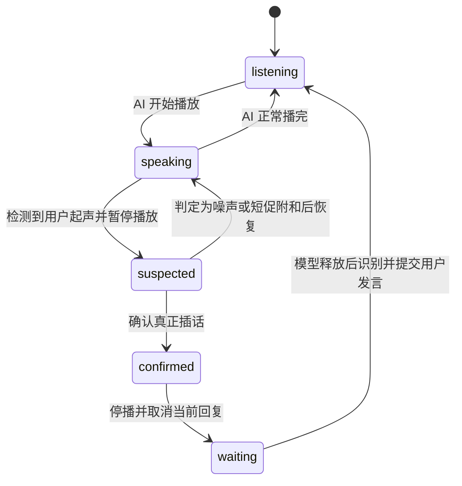

# 长聊连续性与语音接话及人物成长开发设计

开发设计稿，更新于 2026 年 11 月 23 日。

实施状态（2026-11-23）：第 1、2、3、5 阶段已实现并通过自动化回归；网页在桌面与 390 px 宽度完成摘要、人物建议与版本回退验收。第 4 阶段中文语义轮次模型仍处于语料与真机评估前，实时页继续使用能量与持续时间启发式。第 6 阶段的用户、接口和人工验收文档已更新，长时间联调与真实 LLM 质量仍需按人工清单记录。

本次开发围绕三个使用场景展开。用户长聊后能够继续讨论先前的问题，说话时能够停顿和插话，人物能够根据多次互动提出有依据的交流风格调整。实现沿用 FastAPI、SQLite、现有浏览器前端和单模型执行线程。

实施基线包含当前工作区的人物记忆审批改动。已确认事实保存在 `memories`，自动提炼写入 `memory_candidates`，人物设定在会话创建时保存为 `character_snapshot`。下文的新表、新接口和交互均属于拟开发内容。

## 一 现有能力与开发目标

| 方向 | 当前实现 | 本次开发结果 |
| --- | --- | --- |
| 长聊连续性 | `ChatService.history()` 读取最近 10 组符合条件的问答。人物额外读取最多 30 条已确认事实 | 在同一会话加入有来源、可编辑、可回退的历史摘要，补充近期问答之外的重要经过和未完成事项 |
| 自然语音接话 | 浏览器按音量和自适应噪声阈值检测说话，默认约 150 ms 确认起声、700 ms 静音结束。检测到插话后停止播放并请求取消 | 支持环境校准、可恢复的播放暂停和插话确认，评估中文语义轮次检测，减少抢话和误打断 |
| 人物成长 | 人物可手动编辑。新会话保存人物快照，长期事实通过独立候选审批 | 根据多次有效互动生成交流风格调整建议，显示来源，确认后形成可回退的人物版本 |

三个方向共用现有回复终态规则。`complete`，以及正文完整的 `audio_failed` 可以成为后台整理的来源。被取消、打断、正文未完成和转写失败的轮次跳过。音频重试按同一回复去重。

## 二 长聊连续性

### 用户流程

会话持续变长后，后台整理已经离开最近 10 组问答的历史。下一轮读取当前有效摘要，再读取摘要之后的近期问答。用户通过会话菜单打开「会话摘要」，查看覆盖时间、摘要条目和原始来源，可以编辑、清空或恢复上一版本。

摘要按 `conversation_id` 隔离，普通文字、实时人物会话及纯声音会话均可使用。跨会话长期事实继续通过人物记忆审批。摘要中的建议和共同经历引用对应历史消息，角色自身生成的建议保留发言者标识。

### 摘要内容与生成规则

摘要使用结构化条目，每条包含 `kind`、`text` 和 `source_message_ids`。

| `kind` | 含义 | 示例 |
| --- | --- | --- |
| `user_statement` | 用户在本会话明确说过的情况 | 用户正在考虑换工作，主要顾虑是通勤 |
| `assistant_suggestion` | 人物曾提出的建议 | 人物建议先比较两份工作的实际通勤时间 |
| `open_thread` | 用户已表达、仍待继续讨论的问题或约定 | 用户希望下次继续整理面试问题 |

首版拟采用以下工程参数，后续根据实际聊天样本调整。

- 保留最近 10 组有效问答作为近期上下文。
- 首次达到 20 组有效问答时，为前 10 组生成摘要。之后每新增 10 组可压缩问答更新一次。
- 每次最多处理 20 组新问答，连同上一份有效摘要一起整理。每版最多 12 条，每条最多 160 字，总计最多 1200 字。
- 单次输入初始上限为 12000 字符，包含摘要和待压缩消息。按时间顺序选取完整问答，超出预算时分批追赶至本次目标覆盖边界，游标随实际处理范围推进。
- 输入使用原始已提交消息。每个输出来源必须属于本批或上一版仍有效的来源集合。
- 按消息顺序处理纠正。遇到新旧说法矛盾时，条目写明最新说法与对应时间，用户可查看原文。

每轮构造上下文时固定本轮的摘要版本、人物快照和记忆版本。读取最近问答的截止点为当前用户消息之前，摘要覆盖区间与原始问答注入区间去重。

后台更新失败或落后时，使用上一份有效摘要，并带上覆盖边界之后的最新问答，最多 20 组。超过这一窗口的未压缩历史在摘要面板标记为待整理。聊天请求可继续执行，后台失败可单独重试。

### 数据结构

新增两张表，版本记录采用追加写入。具体建表代码与迁移测试在实现阶段一并提交。

| 表 | 主要字段 | 一致性约束 |
| --- | --- | --- |
| `conversation_summary_state` | `conversation_id`、`current_revision_id`、`generation`、`target_assistant_id`、`excluded_source_ids`、`status`、`error`、`updated_at` | 每个会话一行。`generation` 用于拒绝过期后台结果，目标边界用于分批追赶 |
| `conversation_summary_revisions` | `id`、`conversation_id`、`parent_id`、`items_json`、`covered_until_assistant_id`、`source_digest`、`origin`、`created_at` | 来源消息需属于该会话。`origin` 取 `auto`、`manual`、`rollback` 或 `clear` |

`source_digest` 由覆盖区间、来源消息正文、回复终态、`text_finalized`、`attempt` 和上一版本标识计算。后台提交前重新校验来源、`generation` 和快照中的 `memory_version`。候选版本插入与当前版本指针切换放在同一事务中。

手动编辑时提交读取到的当前版本，版本不匹配返回 `409`。回退会重新校验目标版本的来源，复制有效内容并生成新版本，保留回退关系。目标包含已失效来源时返回 `409`，用户可以基于仍有效的条目重新编辑。清空也写入新版本，并推进 `generation`，让已经运行的整理任务失去提交资格。清空会话摘要后，用户可以手动重新整理历史。

删除或纠正原始消息时，使依赖该消息的摘要失效。删除已确认长期记忆时，递增记忆版本，将该条在所属会话中的 `source_id` 加入 `excluded_source_ids`，并移除当前摘要里引用该来源的条目。后续生成、编辑和回退都校验排除集，避免旧摘要重新带回撤销内容。原始消息仍可在会话记录中查看，删除原始聊天通过独立的数据管理操作执行。用户将来重新表达对应情况时，使用新的来源消息。

### 提示词与后台执行

`ChatService.history()` 按系统规则、人物快照、已确认事实、会话摘要、近期原始问答、当前用户消息的顺序构造请求。摘要放在标记了来源和角色的 JSON 数据段，消息内的指令作为聊天内容处理。

在现有后台提炼执行器上调度摘要任务，使用独立的 `TaskControl`、10 秒初始预算和严格输出校验。每次执行器只运行一个后台任务，待处理工作保存在 SQLite 状态中，每个实体至多登记一份待处理状态。当前聊天及人物事实提炼优先，摘要随后执行。

重启时把运行中的整理任务标为中断，保留上一有效版本。用户重试后重新读取来源和版本。模型超时、非法来源、截断输出或数据库提交失败均保留原版本与覆盖边界。

### 拟新增接口

| 方法与路径 | 请求与响应 |
| --- | --- |
| `GET /api/conversations/{id}/summary` | 返回当前版本、结构化条目、覆盖边界、后台状态和错误 |
| `GET /api/conversations/{id}/summary/revisions` | 按时间分页返回版本列表，每页最多 20 条 |
| `POST /api/conversations/{id}/summary/refresh` | 后台重新整理，返回 `202`。重复提交返回同一待处理状态 |
| `PUT /api/conversations/{id}/summary` | 提交 `base_revision_id` 和修改后的条目，原来源标识需有效 |
| `POST /api/conversations/{id}/summary/rollback` | 提交 `base_revision_id` 和 `target_revision_id`，返回新版本 |
| `DELETE /api/conversations/{id}/summary` | 提交 `base_revision_id`，创建清空版本并使在途任务过期 |

允许首次 `base_revision_id` 为 `null`。用户编辑可以修改条目表述和删除条目，补充新事实仍使用现有「添加记忆」。所有跨会话版本引用返回 `404`。

## 三 更自然的语音接话

### 环境校准与轮次结束

开始实时会话后提供约 1 秒环境校准，估计背景噪声。用户开始讲话时停止采集噪声样本，采用已有自适应阈值继续监听。校准过程显示状态，用户始终可以暂停麦克风或结束会话。

首版提供「正常停顿」和「慢速表达」两档，初始静音窗口分别为 700 ms 和 1100 ms。起声阈值、噪声估计与结束窗口分别设置，参数在下一段录音开始时生效。单段最长 30 秒，前置缓冲沿用 200 ms，段尾样本保留到端点判定完成。

端点判断记录本次使用的档位和最终时刻。对“我想了一下……还是明天再说”这类句内停顿，允许在结束窗口内继续累积原录音。

### 可恢复的播放暂停

现有 `VoiceAudio.Player.stop()` 会中止请求并关闭 `AudioContext`。新增 `pause()` 和 `resume()`，供实时页处理疑似插话。播放器分别记录播放状态和完成状态。

- `pause()` 暂停播放上下文，保存实际消费位置。录音使用自己的 `AudioContext`，继续接收用户声音。
- PCM 调度使用音频时钟。已调度与待调度样本总量保持有界，暂停时网络读取按现有背压规则等待。
- 结束计时器按剩余音频时长重算。暂停期间收到流结束，也要等待恢复后播放完缓冲才能上报播放结束。
- `resume()` 校验当前 `session`、`round`、消息 UUID 和 `attempt`。只有仍属同一播放实例的暂停可以恢复。
- 结束会话、真实插话、切换声音或播放故障调用 `stop()`，停止后废弃对应恢复请求。

### 插话状态与取消时机

将实时页的插话分为 `suspected`、`confirmed` 和 `dismissed`。以下状态存在于客户端单次会话内。

疑似插话只暂停本地播放，保持当前 SSE 和回复实例。确认后才关闭旧 SSE、推进轮次、请求取消，确保误判后仍可从实际暂停位置续播。取消请求携带目标 `attempt`，服务端在现有取消入口校验实例，过期请求返回 `409`，避免取消已重试的同一消息。

第一阶段用校准后的 VAD 和说话持续时间区分噪声，先解决短噪声导致不可恢复停播的问题。拟以 350 ms 持续人声作为初始确认条件，短促声音在结束后恢复。这个规则对“停”等短词需要专项验收，语义识别在下一阶段补齐。

插话音频使用独立的最短长度，初始拟设为 150 ms，使语义检测能接收短促接管词。普通提问继续沿用 500 ms 最短录音规则。过短片段只参与插话判断，识别通过后才能作为新一轮用户消息提交。

第二阶段评估中文语义模型，输入近期轮次和当前音频，判断发言是否完整，以及“嗯、对”属于附和还是接管话轮。模型需明确支持中文，并在本机测量资源占用、误判和新增延迟。通过验收后替换启发式确认条件。“停”“等一下”等明确接管请求，以及持续人声超过 1.2 秒的情况优先确认插话，避免分类等待持续阻塞用户发言。

语义判断需要在疑似插话期间独立完成。模型加载和运行方式必须与现有 Breeze、Whisper 的串行执行约束兼容。若方案依赖等到旧 TTS 取消后再运行 Whisper，只能用于最终转写，疑似插话的可恢复判断采用已通过验收的轻量检测路径。

### 取消后的一致性

真正插话时，用户录音继续保留，后续识别等待旧模型调用退出。复用当前 `cancelPending` 和 `waitIdle()` 的轮次校验，旧网络回调按实例丢弃。单次录音最多提交一次，网络重试沿用同一个幂等键。

服务端已经 `complete`、客户端尚未播完时，只停止剩余播放。取消接口返回已完成状态后，客户端继续处理用户的新发言。播放结束与疑似插话同时发生时，由当前播放实例的状态作一次裁决。

暂停超过 2 秒且仍无法完成分类时，转为确认插话并进入现有取消流程。模型长时间未释放、麦克风失效和网络断连应显示可操作的状态，用户可以输入文字或结束会话。

### 测量与初始验收目标

所有延迟使用浏览器单调时钟记录。端到端首音从用户最后一个有效语音样本开始，经过端点判定、识别、聊天和合成，直到浏览器实际开始播放。服务端首 PCM 作为辅助定位指标。

| 指标 | 测量口径 | 拟采用的首轮门槛 |
| --- | --- | --- |
| 打断响应 | 用户有效起声至本地暂停播放 | 预热后 P95 不高于 300 ms |
| 误打断恢复 | 确认为噪声或附和至原播放恢复 | P95 不高于 300 ms，恢复后无重复或跳句 |
| 接话延迟 | 说完至浏览器出声 | 与同机旧实现比较，P95 增幅不超过 200 ms |
| 噪声误打断 | 固定噪声与外放场景中，导致实际取消的误判次数 | 相同样本下较旧实现减少至少一半 |
| 中文语义检测 | 带标签的停顿、附和、真实插话录音 | 至少 30 段固定样本，报告混淆矩阵及每段结果后决定是否启用 |

门槛属于开发目标。采集时固定硬件、声音、LLM、麦克风和耳机状态，分别记录冷启动及预热结果。每个性能场景至少 30 次，报告原始值、中位数、P95 和最大值。浏览器音频时钟测量辅以回环录音，检查实际输出设备延迟。

## 四 可追溯的人物成长

### 成长建议的生成

在人物面板增加「交流风格建议」和「版本历史」。用户查看建议的原值、新值、原因及来源消息，可以确认、编辑后确认、驳回或重新审阅。

首版允许建议调整 `speech_style` 和 `personality` 两个字段。建议围绕可观察的交流习惯，例如直接程度、追问频率、幽默程度和解释长度。人物名称、声音、背景、关系和示例继续通过现有人物编辑表单管理。

建议依据用户对互动方式的明确反馈和已确认的交流偏好。人物自己生成的自我描述、用户引用的其他人物台词以及一次性的情绪表达需要在提炼时排除。每条建议至少引用两条来自不同有效轮次、表达一致的用户消息。

初始触发条件拟设为新增 20 轮符合条件的互动，来源覆盖至少两个会话。每批最多读取 20 轮新来源和已确认的相关交流偏好，只生成一条待审建议。新建议需等待上一条处理完毕。用户可以随时通过现有表单手动修改人物。

复用后台执行器及来源校验，新增独立的 `growth_cursor`，沿用 `memory_turns.seq` 对来源轮次排序。生成候选与推进游标在同一事务提交，失败保留游标供重试。每轮后台调度依次处理事实候选、会话摘要、人物建议，期间新增的同类请求合并到下一轮，避免持续的事实整理使其他工作长期等待。

### 人物版本数据

| 数据 | 字段或新增表 | 行为 |
| --- | --- | --- |
| 当前人物 | `characters.profile_revision_id`、`growth_cursor`、`growth_status`、`growth_error` | 当前档案指向一个不可变版本，整理状态独立于事实记忆状态 |
| 版本历史 | `character_profile_revisions` | 保存完整 `CharacterInput` JSON、人物 ID、父版本、来源候选、变更原因、`origin` 和创建时间 |
| 待审建议 | `character_profile_candidates` | 保存人物 ID、目标字段、原值、新值、原因、来源消息集合及摘要、`base_revision_id`、`base_memory_version`、`review_token`、创建时间 |
| 会话来源 | `conversations.character_revision_id` | 新会话记录所使用的人物版本，并继续保存 `character_snapshot` |

提炼结果经过严格字段白名单和现有 `CharacterInput` 长度校验。主题与事实相关的变化进入现有 `memory_candidates`，交流风格变化进入人物建议。建议内容在确认后才能用于新会话。

### 确认与生效

确认请求携带 `review_token` 和 `base_revision_id`。服务端重新核对来源人物、目标字段、当前档案版本和提炼时的记忆版本，版本变化返回 `409`。用户重新审阅最新差异后再提交确认。

确认时在同一事务写入新的人物版本、更新 `characters.profile` 与版本指针、消费候选。版本记录中的来源候选 ID 具有唯一约束，重复确认可查询已提交版本。手动编辑和回退也通过这一入口追加版本，网络超时后先刷新状态。

新版本在新建普通或实时人物会话时生效。当前会话展示所用版本，用户可点击「用新版本开始对话」。这种生效规则沿用已有会话快照语义。回退生成一个新的版本，历史记录保留原有版本链。

回退后显示被恢复的版本和变更原因。重启恢复时，档案、审批记录和会话快照需能独立读取，后台生成失败应保留当前人物版本。

### 拟新增接口

| 方法与路径 | 请求与响应 |
| --- | --- |
| `GET /api/characters/{id}/profile-revisions` | 按时间分页读取版本、变更原因和来源，每页最多 20 条 |
| `GET /api/characters/{id}/profile-candidates` | 返回当前待审建议、基线版本、来源及审阅令牌 |
| `POST /api/characters/{id}/profile-candidates/refresh` | 根据未处理有效轮次生成建议，返回 `202` |
| `POST /api/characters/{id}/profile-candidates/{candidate_id}` | 复用 `approve`、`reject`、`review` 操作，确认时可附修改后的新值 |
| `POST /api/characters/{id}/profile-rollback` | 提交当前版本和目标历史版本，返回追加生成的新版本 |

现有 `PUT /api/characters/{id}` 接入版本写入，并支持可选 `base_revision_id`。前端提交基线以检测并发编辑，已有调用方沿用原请求格式时保持现有完整替换语义。字符校验、声音引用验证和快照创建复用当前代码。

## 五 共用的数据与迁移规则

所有新增实体使用 UUID，并验证会话、人物和来源归属。API 对不存在或跨人物的资源返回 `404`，非法请求返回 `422`，版本冲突或忙碌返回 `409`。后台任务接受后返回 `202`，前端通过状态查询确认结果。

模型输入仅携带完成当前整理所需的消息和已确认资料，输出作为结构化数据校验。日志只记录实体 ID、阶段、数量、耗时和错误码。候选、摘要与人物变更继续显示来源，原文按当前 LLM 设置发送。

迁移使用 SQLite 备份接口生成独立备份，再在事务中建表、添加列和回填。现有事实及来源保留。初始人物版本取当前档案，旧会话继续读取原 `character_snapshot`，其 `character_revision_id` 可以为空并显示为历史快照。声音会话的摘要独立保存，人物成长仅处理人物会话。

各阶段可独立升级。回退应用版本前停止服务并保存最新数据库与音频，回滚数据库时明确迁移后新增数据的去向。新增版本记录采用追加方式，引用有效性通过外键和事务校验。

## 六 文件改动范围

| 文件或目录 | 开发职责 |
| --- | --- |
| [voice_app.py](../voice_app.py) | 统一上下文构造、摘要及人物版本接口、后台触发、取消实例校验 |
| [character_store.py](../character_store.py) | 人物建议、版本追加、事实变更对相关来源的失效处理 |
| `conversation_summary.py` 拟新增 | 会话摘要的 SQLite 存取、来源校验及版本操作，LLM 调用复用现有服务 |
| [web/app.js](../web/app.js) 与 [web/index.html](../web/index.html) | 摘要面板、人物建议、差异审阅与版本历史 |
| [web/vad.js](../web/vad.js) | 环境校准、独立的起声与端点参数、可测试的录音边界 |
| [web/audio.js](../web/audio.js) | 可恢复暂停、音频时钟、缓冲背压和实例校验 |
| [realtime_web/app.js](../realtime_web/app.js) | 插话状态、取消时机、错误恢复和浏览器指标 |
| [tests](../tests) | 摘要及人物版本后端回归，VAD、播放器和实时交互前端回归 |
| [WEB_APP.md](WEB_APP.md) 与 [MANUAL_TESTS.md](MANUAL_TESTS.md) | 实施后更新用户操作、接口及真机验收记录 |

语义轮次模型在评估通过后确定独立模块和依赖位置。先确认中文效果、授权条件、硬件支持和下载体积，再提交对应依赖变更。

## 七 开发顺序

| 阶段 | 交付内容 | 完成条件 |
| --- | --- | --- |
| 1 | 摘要表及迁移、统一历史读取、后台生成和失败恢复 | 长会话超出最近 10 组后仍能引用有效经过，版本提交及来源校验通过回归 |
| 2 | 摘要编辑与回退面板、手工验收 | 文字和实时入口使用同一份摘要，来源可查、编辑冲突可处理 |
| 3 | 播放器暂停续播、VAD 校准、启发式插话确认 | 短噪声后续播，无重复或跳句，真实插话仍可取消并接新一轮 |
| 4 | 中文语义轮次检测对照与接入 | 固定中文语料通过质量验收，延迟及资源测量达到门槛 |
| 5 | 人物版本、建议提炼、确认及回退 | 多轮反馈生成有来源的建议，新会话使用新版本，旧会话可追溯 |
| 6 | 长时间联调和文档更新 | 长聊、背景提炼、插话、重启和并发编辑组合场景均通过 |

摘要和人物版本的后台工作依赖现有记忆审批基线。语音开发可在摘要面板之后独立推进。模型执行调度涉及的变更与[现有架构优化方案](ARCHITECTURE_DESIGN.md)逐项核对实现状态，接口实施以当前代码为准。

## 八 验收用例

| 范围 | 场景 | 期望结果 |
| --- | --- | --- |
| 长聊 | 连聊超过 40 轮，再询问前半段尚未解决的问题 | 摘要包含有来源的经过，最近问答覆盖后续变化 |
| 长聊 | 明确纠正旧说法后继续聊天 | 当前消息优先，后续摘要反映纠正与来源 |
| 长聊 | 手动编辑摘要时后台任务正在返回 | 后台旧结果因版本失配丢弃，手动内容可追溯 |
| 长聊 | 清空摘要、删除事实或修改来源时任务在途 | 已失效任务失去提交资格，相关派生条目退出当前摘要 |
| 长聊 | LLM 返回非法 JSON、其他会话来源或截断输出 | 保留旧摘要与覆盖边界，显示失败并允许重试 |
| 隔离 | 两个人物共用声音，另有纯声音会话 | 摘要按会话隔离，事实和成长建议按人物隔离 |
| 语音 | 正常语速、慢速语句及句内思考停顿 | 按所选档位提交同一段录音，前后音节完整 |
| 语音 | 播放时短噪声或无接管意图的“嗯、对” | 检测阶段暂停，确认误判后从暂停位置续播 |
| 语音 | 播放时说“停”“等一下”或持续插话 | 在语义阶段验收通过后确认取消，录音完整提交一次 |
| 语音 | 暂停期间流结束、关闭会话或切换选择 | 事件按实例裁决，过期恢复和播放回调失效 |
| 语音 | 打断后旧请求超时或同消息已重试 | 目标 `attempt` 校验有效，新轮次及终态不会被旧回调覆盖 |
| 成长 | 多个会话中重复表达交流方式偏好 | 生成引用多条用户消息的待审建议 |
| 成长 | 一次抱怨、引用台词或人物自述 | 对应内容无法满足成长依据要求 |
| 成长 | 候选生成后手动改档案，再确认旧候选 | 返回 `409`，重新审阅后才可提交 |
| 成长 | 确认后新建文字及实时会话，再回退版本 | 各会话快照能追溯到创建时版本，回退形成新的历史记录 |
| 兼容 | 带历史人物、事实、音频和会话的 SQLite 升级 | 数据和来源可读，迁移失败回滚，备份可恢复 |
| 联调 | 长聊期间并行提炼、频繁插话、网络断流和重启 | 聊天状态可解释，后台任务有界，已确认数据和版本一致 |

自动化继续使用仓库已有 Python 和 Node 测试入口。播放器与 VAD 回归加入确定性帧和音频时钟替身，数据库回归使用隔离目录及历史库副本。语义判断使用固定中文录音集逐条标注，真机测量按第三节记录。

## 九 借鉴依据

SillyTavern 的摘要扩展支持编辑与恢复上一摘要，World Info 支持按会话或人物组织并动态注入相关资料。本方案借鉴摘要审阅、来源关联和上下文预算管理。[摘要文档](https://docs.sillytavern.app/extensions/summarize/)、[World Info 文档](https://docs.sillytavern.app/usage/core-concepts/worldinfo/)

LiveKit 将轮次结束、插话判断及误打断恢复作为独立交互问题处理。本方案借鉴可恢复的暂停与插话确认流程，中文检测效果通过项目自己的语料和硬件测量决定。[轮次与插话文档](https://docs.livekit.io/agents/logic/turns/)

Letta 的 MemFS 将人物及用户资料持久化，并记录版本历史。本方案用 SQLite 保存人物版本、审阅依据和回退关系，接入现有会话快照。[MemFS 文档](https://docs.letta.com/concepts/memfs)
